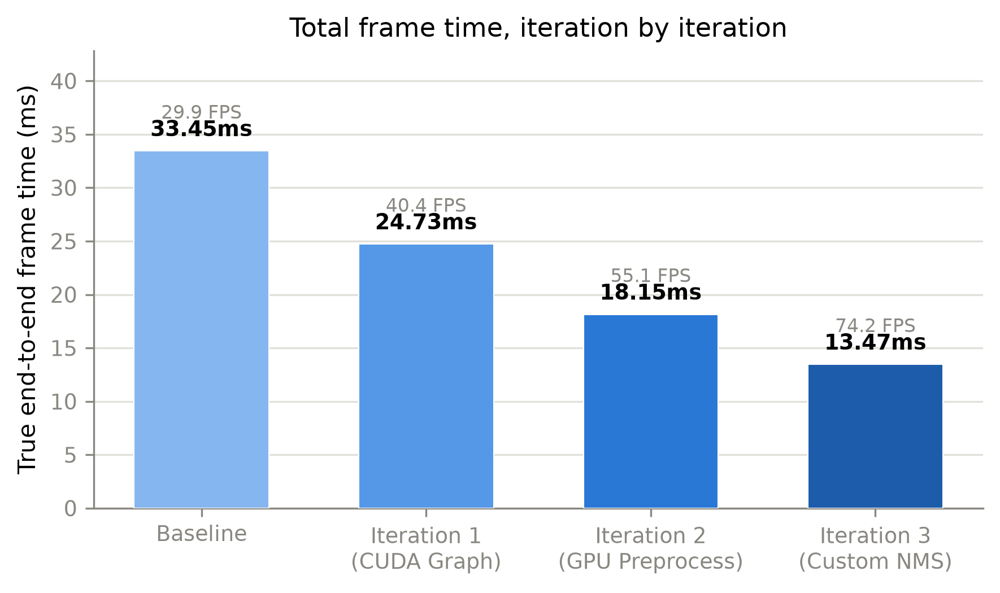
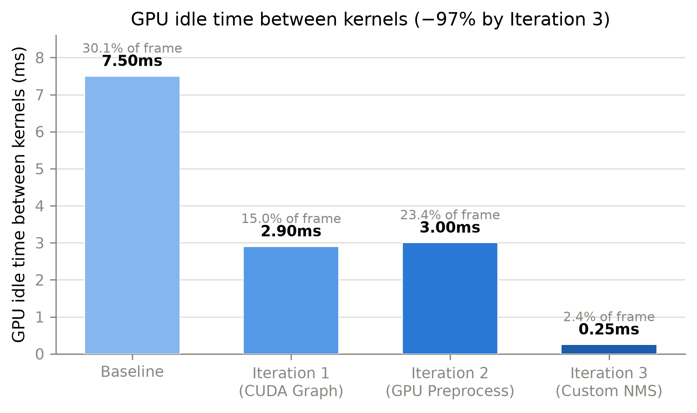
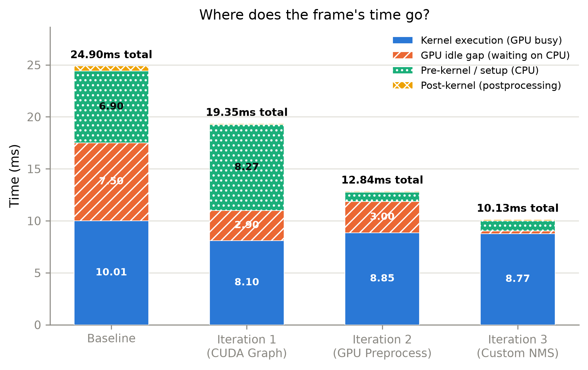
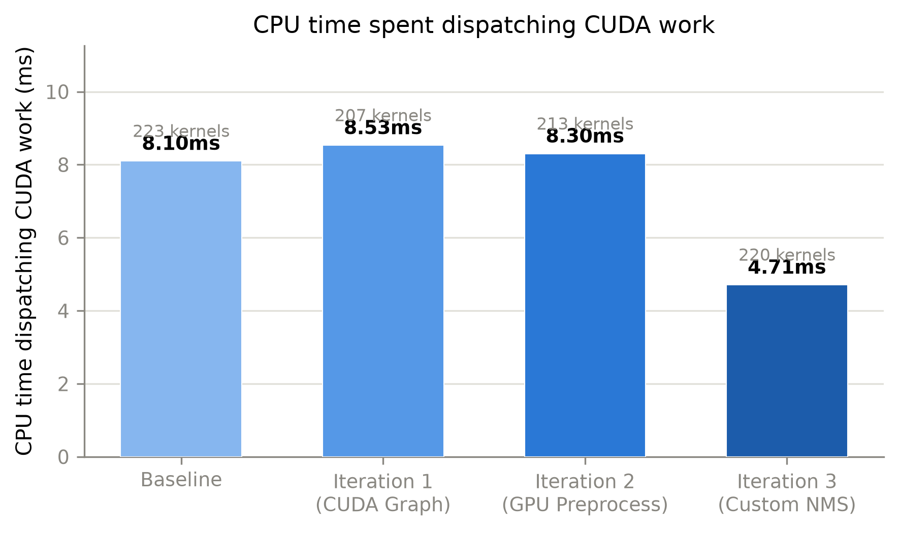
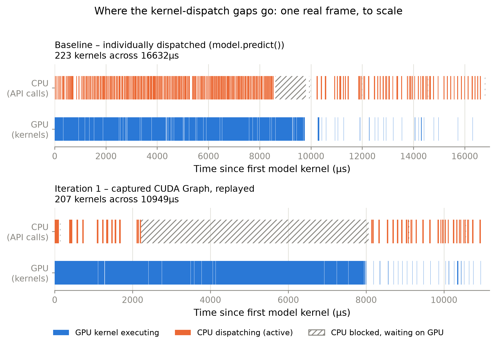
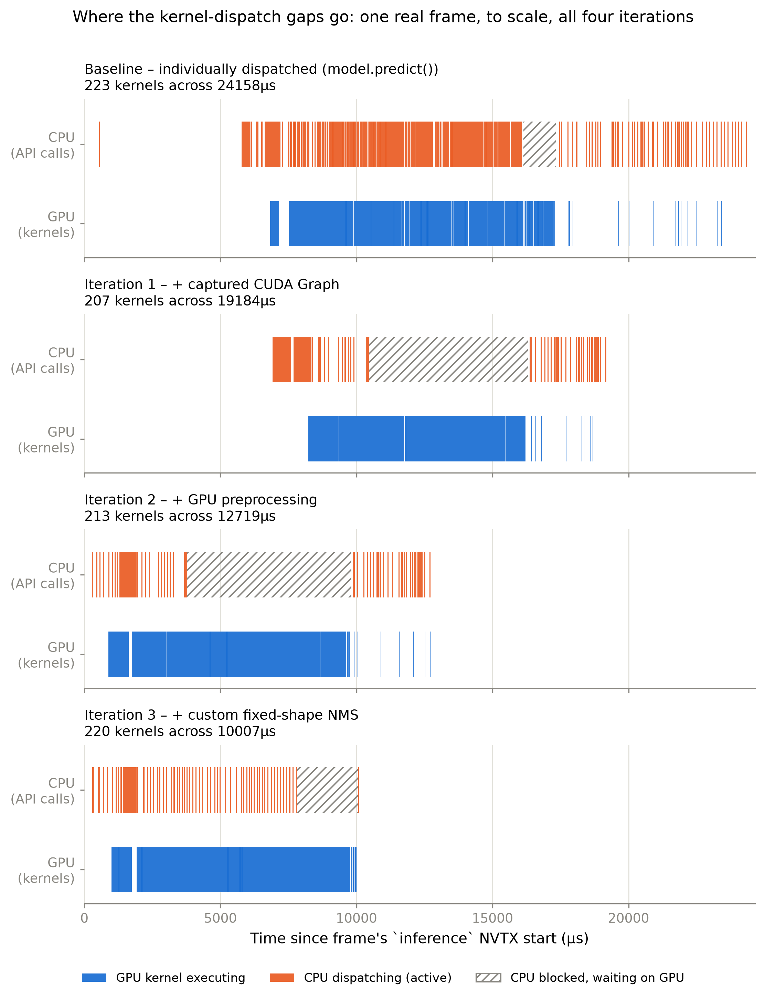

# Paper
*Exported from Notion (page last edited 2026-10-01).*

*[Overleaf project link removed – the draft is in the project's Overleaf]*

## Introduction

- SAR context (the helicopter), and why detection has to run at the edge rather than in the cloud
- Project task: evaluating hardware solutions for the Edge compute platform
- Scope: profiling methodology and demo models (faktisk modell er master-mat)
- Possible research questions:
  1. How can we instrument an edge platform to produce traceable performance data for an object-detection pipeline running on a video feed?
  2. Where does the time go in a TensorRT detection pipeline on the Jetson Orin Nano?
  3. Which pipeline-level optimizations reduce latency without reducing numerical precision, and do they carry over from different object-detection models (CNN vs. Transformer)

## Background/motivation

- The SAR AI system architecture → diagram and highlight our work on the diagram
- The Jetson Orin Nano choice: hardware details and everything
- TensorRT and the CUDA execution model: kernel launches, streams, synchs
- Nsight systems vs. Nsight compute, plus NVTX. What each tool answers and profiles
- Detector families: YOLO (CNN) and RF-DETR (Transformer)
- Numerical precision?

## Possible related work section

- Most benchmarks report model latency. We measure whole pipeline and try to explain why it takes the time it does.
- CPU and GPU profiling

## Experiments

- Benchmark/baseline yolo

## Methodology

|  | Optimization iterations | Kernel analysis (Nsight Compute) |
| --- | --- | --- |
| Question | "What can we change to make the pipeline faster?" | "Why does the remaining GPU work take this long?" |
| Tool | Nsight Systems (the whole timeline) | Nsight Compute (inside individual kernels) |
| Result | ms saved per change | Whether a kernel is limited by compute or memory, and how full the GPU is |

## Baseline characterization

## Optimization Iterations

1. Nsight systems iterations

## Results

## Towards the operational model (short bridge to the thesis)

## Discussion

- How suitable is the Orin Nano? What imits it once the overhead is gone
- What the testbed and MVP can tell about the real system

## Conclusion

### Figures

We should have a nsys timeline screenshot of one frame, baseline vs. CUDA graph. Shows the idle gaps disappear better than the tables.

All figures below are generated by `scripts/plot_paper_figures.py` (PNG @300dpi + vector PDF also available in `reports/figures/` for print use) from the verified numbers documented on the Baseline/Iteration 1-3 pages, re-checked against the raw `.sqlite` reports.

**Figure 1 - Total frame time per iteration.** True end-to-end time per frame (decode start to draw end), measured directly from raw NVTX timestamps. Frame time drops from 33.45ms to 13.47ms across the three iterations (29.89 -> 74.22 FPS), roughly a 2.5x overall speedup.

*Total frame time per iteration*

**Figure 2 - GPU idle time between kernels.** Isolates the specific cost CUDA Graph (Iteration 1) targets: time the GPU spends sitting idle, waiting for the CPU to dispatch the next kernel. Collapses from 7.50ms (30.1% of the frame) at baseline to 0.25ms (2.4%) by Iteration 3 - a 97% reduction, achieved in two separate steps (the model's own idle gap at Iteration 1, then a second, unrelated idle-gap source in NMS fixed at Iteration 3).

*GPU idle time between kernels, by iteration*

**Figure 3 - Where does the frame's time go?** Stacked decomposition of the same total into four categories: kernel execution (GPU busy), GPU idle gap, pre-kernel/setup (CPU-side preprocessing before any kernel dispatches), and post-kernel (postprocessing). Shows two distinct collapses: the aqua pre-kernel/setup segment shrinks at Iteration 2 (preprocessing moved CPU->GPU), and the orange idle-gap segment shrinks a second time at Iteration 3 (fixed-shape NMS removes the GPU->CPU syncs that were causing it).

*Stacked breakdown of frame time by category, per iteration*

**Figure 4 - CPU time spent dispatching CUDA work.** Cumulative CPU-side cost of every `cudaLaunchKernel`/`cudaGraphLaunch`/`cudaMemcpyAsync` call in the frame. Kernel count (labeled above each bar) barely changes across iterations (223 -> 207 -> 213 -> 220) - CUDA Graph collapses the *dispatch calls* for the model into one launch, but does not reduce the number of kernels that execute, and preprocessing/NMS still dispatch individually until later iterations. Dispatch time only drops substantially at Iteration 3, once NMS's own dynamic-shape dispatching is fixed.

*CPU dispatch time per iteration, with kernel count*

**Figure 5 - CPU/GPU swimlane: one real frame, to scale.** The mechanism behind Figures 1-4, made visible. Unlike the other figures, this is *not* a summary statistic - every rectangle is a real, individual GPU kernel or CPU API call, timestamped directly from the nsys sqlite export for one representative frame (frame index 100, well past warm-up), drawn to the same time scale within each panel. Top panel: Baseline (`model.predict()`). Bottom panel: Iteration 1 (captured CUDA Graph).

Three regions in the **baseline** panel: (1) 0-9,500us, the model's \~189 layers, each individually dispatched (dense orange CPU row, each kernel preceded by its own launch call); (2) \~8,600-9,800us, a hatched `cudaStreamSynchronize` block - the CPU has dispatched everything and blocks waiting for the last kernels to finish; (3) \~9,800-16,600us, NMS - only \~34 kernels but 6.8ms wall-clock, because each one needs a GPU->CPU round trip to learn how many boxes survived confidence filtering before the next kernel can even be sized.

Same three-region structure in the **Iteration 1** panel, very different balance: (1) 0-1,700us, a small number of kernels TensorRT's Myelin backend does not capture into the graph (an honest nuance - graph capture is not all-or-nothing); (2) \~2,200-8,000us, one `cudaGraphLaunch` call has already fired and the CPU now simply blocks in `stream.synchronize()` for 5.8ms straight (hatched) while the GPU works through the entire \~166-kernel model unsupervised; (3) \~8,100-10,900us, NMS again - identical code, identical gappy character to the baseline panel, since NMS is not touched until Iteration 3. The legend at the bottom distinguishes GPU execution (blue), active CPU dispatch (orange), and CPU blocked/waiting (hatched) - collapsing a blocking wait into the same visual as active dispatch was an early mistake caught and corrected while building this figure, since a multi-millisecond wait rendered identically to dispatch work would have implied the CPU was busy when it was actually idle.

*CPU/GPU swimlane: baseline (individually dispatched) vs. Iteration 1 (captured CUDA Graph replay), real per-kernel timestamps for one representative frame*

---

> ⚠️ **Figure 5 superseded** - the swimlane above (Baseline vs. Iteration 1 only) has been replaced by the 4-panel version below (all iterations, corrected wait-classification). Please delete the old "Figure 5" paragraph and image above (just before this divider) - an editing-tool limitation prevented removing it automatically.

**Figure 5 (revised) - CPU/GPU swimlane: one real frame, to scale, all four iterations.** The mechanism behind Figures 1-4, made visible. Unlike the other figures, this is *not* a summary statistic - every rectangle is a real, individual GPU kernel or CPU API call, timestamped directly from the nsys sqlite export for one representative frame (frame index 100, well past warm-up). All four panels share one x-axis (time since the frame's `inference` NVTX start), so the shrinking span across panels is directly, honestly comparable - not four independently-rescaled plots.

Each panel breaks into the same three regions, with a very different balance:

**Baseline** (24,158us total): (1) 0-5,700us, blank - CPU-only preprocessing (`cv2` letterbox/normalize), invisible to the GPU/CPU-API rows; (2) 5,700-16,100us, the model's \~189 layers, individually dispatched (dense orange CPU row); (3) a `cudaStreamSynchronize` block (hatched), then \~16,100-24,158us, NMS - only \~34 kernels but \~8,000us wall-clock, since each needs a GPU->CPU round trip to learn how many boxes survived confidence filtering before the next kernel can even be sized.

**Iteration 1** (19,184us): the same preprocessing gap persists (CUDA Graph doesn't touch preprocessing) before a `cudaGraphLaunch`, then a 5.8ms hatched block - the CPU simply blocked in `stream.synchronize()` while the GPU works through the entire \~166-kernel model unsupervised - then the same gappy, untouched NMS tail as baseline.

**Iteration 2** (12,719us): the preprocessing gap collapses to \~200us and is no longer blank - real GPU kernels now visible (preprocessing moved CPU->GPU). Model + hatched block unchanged from Iteration 1. NMS tail still untouched, still gappy.

**Iteration 3** (10,007us): same short GPU preprocessing and model region, but the hatched block here is *not* a `cudaStreamSynchronize` - it's a long `cudaMemcpyAsync` (\~2.3ms), the blocking `.cpu()` transfer of NMS's fixed-size output. Finding this was itself a correction made while building this figure: classifying "blocked" calls by API *name* (matching `Synchronize`) missed this one entirely, since Iteration 3's blocking wait has a different name than the other three panels'. Fixed by classifying on call *duration* instead (>1ms = blocked, regardless of which API produced it) - a clean, empirically-justified threshold, since every real dispatch call across all four reports finishes under 660us and every real block runs past 1,190us, with nothing in between. After that fix, NMS's own kernels (`gatherTopK`, `triu_tril_kernel`, ...) run as a comparatively tight, un-gappy cluster right after - visually, the payoff of Iteration 3's fixed-shape rewrite.

The legend at the bottom distinguishes GPU execution (blue), active CPU dispatch (orange), and CPU blocked/waiting (hatched).

*CPU/GPU swimlane across all four iterations, real per-kernel timestamps for one representative frame, shared x-axis*
