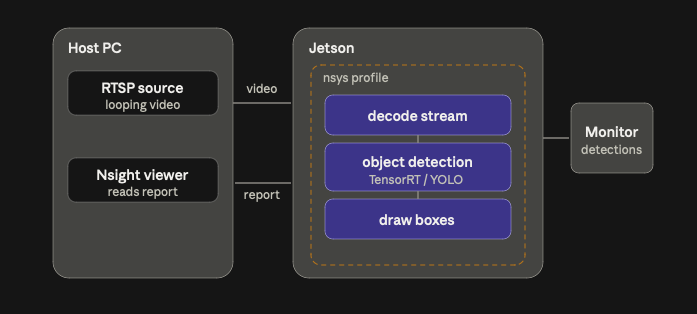

# Replica setup
*Exported from Notion (page last edited 2026-10-21).*

#### Demo

- Demo data: looping traffic/street video streamed from the host over RTSP (stands in for the live camera feed)
- Demo model: Ultralytics YOLO (yolov8n, COCO-pretrained); export to TensorRT for speed
- Pipeline: host RTSP → decode → object detection → draw boxes → monitor, all on the Jetson

Replica with demo data is an MVP with main purpose to get Nsight data we can decode, from a system that is as similar as possible to the future pipeline in the helicopter. If done properly, the demo can be changed to prod, by changing the data feed and model.

#### Profiling approach

- nsys wraps the whole pipeline on the Jetson; capture a bounded window (\~20 s) → produces a .nsys-rep report file
- Add NVTX ranges around decode / inference / draw so the timeline splits into readable phases
- ncu (kernel-level) used offline on a single hot kernel — not on the live feed, since it replays kernels and breaks real-time
- Reports viewed on the host: an x86 Ubuntu host can remote-profile and pull the report automatically; the Mac can only view copied reports

#### Build order

- Get model + display + nsys working first with a local video file / USB camera
- Then swap the local input for the host RTSP stream (one change, not four)
- Ethernet link between host and Jetson carries both directions: video in, report out
