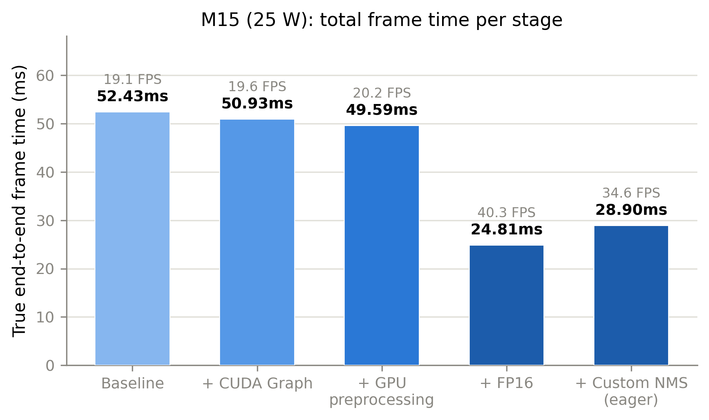
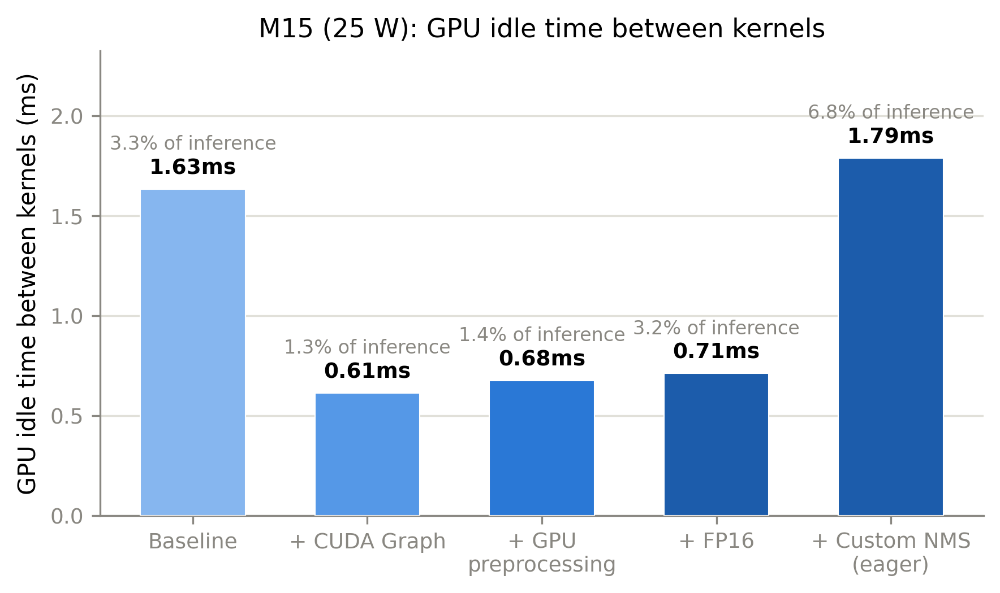
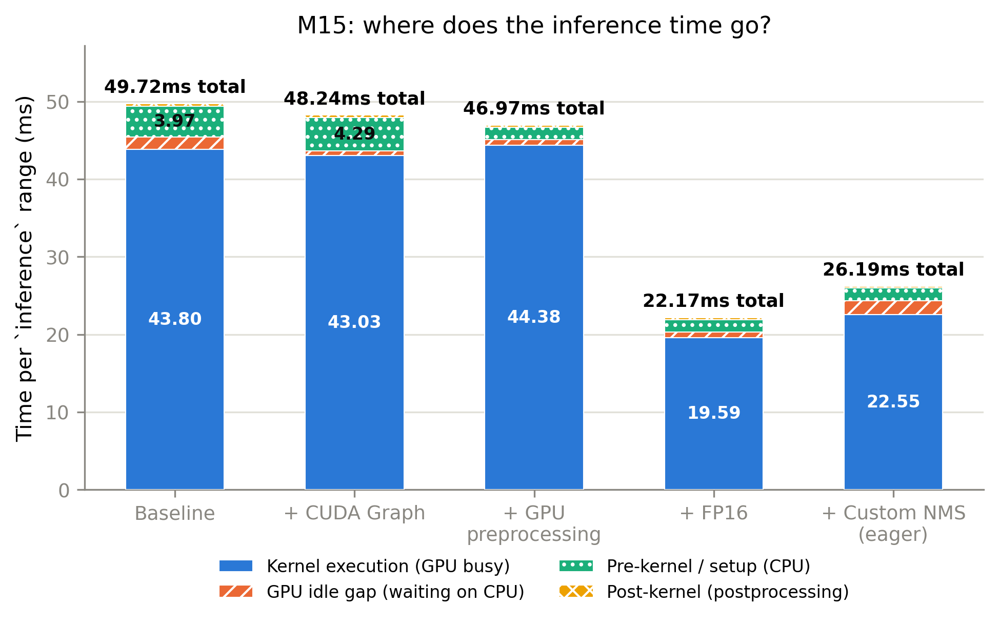
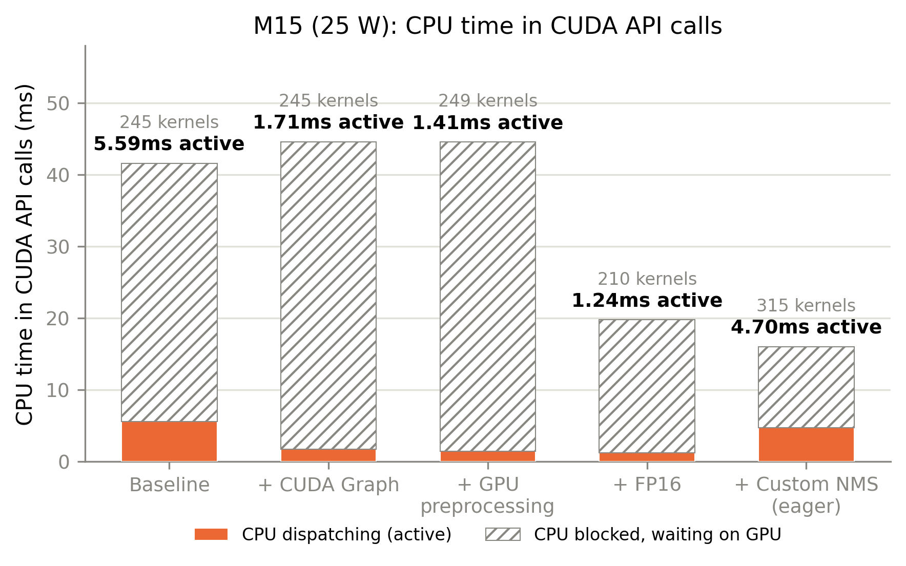
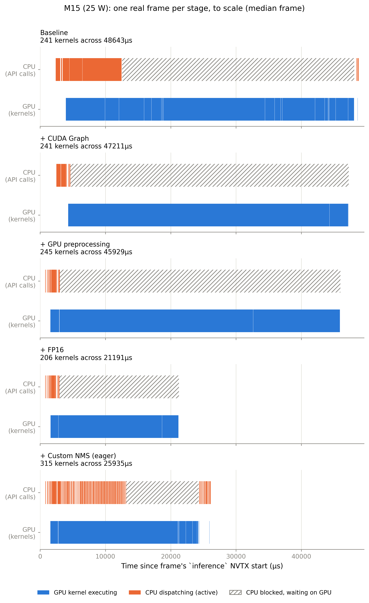

# Results: paper set, 25 W (YOLOv8n + M15)

Both models, every optimization stage, one profiling session on 25.10.2026. These are the numbers for the paper; they replace the earlier per-iteration measurements.

> **Measurement conditions**
> - Jetson Orin Nano Super, **25 W**, `sudo jetson_clocks` (GPU 918 MHz, CPU 1344 MHz, EMC 3199 MHz, all pinned)
> - **Desktop stopped** (`systemctl isolate multi-user.target`), nothing else running; see [measurement-protocol.md](measurement-protocol.md)
> - Video `data/testdata.mkv`, 1920×1080, 600 frames per run, first 50 skipped as warm-up
> - **No throttling:** over-current counters 0 before and after
> - Script: `scripts/profile_paper_set.sh` (git `73c9f3b`), logs in `reports/nsys_paper_reports/logfiles/`

## Summary

| Stage | YOLOv8n FPS | M15 FPS |
|---|---|---|
| Baseline | 49.5 | 19.1 |
| + CUDA Graph | 56.6 | 19.6 |
| + GPU preprocessing | 69.5 | 20.2 |
| + Custom NMS | 72.7 | – |
| + FP16 | **86.7** | **40.3** |
| + Custom NMS (eager) | – | 34.6 |
| **Total speed-up** | **1.75×** | **2.11×** (to FP16) |

FPS = 1000 / mean frame time (decode start to next decode start).

## Key findings
- **Amdahl in action.** YOLOv8n's model is small, so removing overhead (graph, preprocessing, NMS) gives 1.47×. M15's model is 83 % of the frame, so the same steps give only 1.06×.
- **FP16 is the big lever for both:** model GPU time 9.2 → 5.0 ms (YOLO) and 44.4 → 19.6 ms (M15).
- **Custom NMS on YOLO evens out frame times:** median barely changes, but p95 drops 18.6 → 14.1 ms. Ultralytics' NMS costs more on frames with more detections.
- **Custom NMS on M15 is slower (negative result).** Sized for 1000 candidates (1000×1000 IoU matrix, 112 kernels, 3 ms GPU), but the video never has more than 3 candidates per frame. torchvision's NMS needs 0.09 ms GPU. A fixed-shape NMS only pays off inside the CUDA graph and sized to the data.
- **YOLO FP16 is now CPU-bound**, not GPU-bound: further gains need the remaining per-op Python launches (preprocessing, NMS) inside the CUDA graph.

## YOLOv8n

| Stage | Frame (ms) | FPS | Median / p95 (ms) | Pre-kernel CPU | GPU kernels | GPU idle | CPU dispatch (active) |
|---|---|---|---|---|---|---|---|
| Baseline | 20.19 | 49.5 | 19.2 / 23.0 | 3.73 | 8.38 | 3.58 | 4.19 |
| + CUDA Graph | 17.66 | 56.6 | 16.6 / 21.8 | 5.90 | 7.74 | 0.71 | 2.00 |
| + GPU preprocessing | 14.39 | 69.5 | 13.4 / 18.6 | 1.49 | 8.85 | 0.85 | 1.55 |
| + Custom NMS | 13.75 | 72.7 | 13.7 / 14.1 | 1.66 | 9.16 | 0.07 | 2.49 |
| + FP16 | 11.53 | 86.7 | 11.5 / 12.1 | 1.66 | 5.01 | 1.90 | 2.55 |

All times in ms per frame. GPU kernels include the GPU preprocessing kernels from stage 3 on.

*Frame time per stage. 49.5 → 86.7 FPS.*

*GPU idle time between kernels. The CUDA graph removes most of it; in FP16 it grows again because the GPU now waits on the CPU.*

*Where the inference time goes. The CUDA graph removes idle gaps, GPU preprocessing removes CPU pre-kernel time, FP16 halves the model.*

*CPU time in CUDA API calls, split into active dispatch and waiting on the GPU.*

*One real (median) frame per stage, to scale: GPU kernels vs CPU API calls.*

## M15

| Stage | Frame (ms) | FPS | Median / p95 (ms) | Pre-kernel CPU | GPU kernels | GPU idle | CPU dispatch (active) |
|---|---|---|---|---|---|---|---|
| Baseline | 52.43 | 19.1 | 51.6 / 54.2 | 3.97 | 43.81 | 1.63 | 5.59 |
| + CUDA Graph | 50.93 | 19.6 | 50.2 / 52.0 | 4.30 | 43.03 | 0.61 | 1.71 |
| + GPU preprocessing | 49.59 | 20.2 | 48.9 / 51.2 | 1.61 | 44.38 | 0.68 | 1.41 |
| + FP16 | 24.81 | 40.3 | 24.0 / 26.4 | 1.58 | 19.59 | 0.71 | 1.24 |
| + Custom NMS (eager, k = 1000) | 28.90 | 34.6 | 28.8 / 29.2 | 1.62 | 22.55 | 1.79 | 4.70 |

M15's stage order follows the profiling: the model dominated, so FP16 came before NMS.

*Frame time per stage. FP16 doubles the speed; the eager custom NMS takes some of it back.*

*GPU idle time between kernels: small in every stage, because M15 keeps the GPU busy.*

*Where the inference time goes: GPU kernel execution dominates every stage.*

*CPU time in CUDA API calls: almost all of it is the CPU waiting for the GPU.*

*One real (median) frame per stage, to scale.*

## Reproduce
- Jetson (desktop stopped, 25 W, `sudo jetson_clocks`): `bash scripts/profile_paper_set.sh`
- Mac: `python3 scripts/plot_compare_reports.py --name paper25w_yolo --outdir reports/figures/paper25w --reports <5 yolo .sqlite> --labels ...`
- Figures, summary CSVs and logs are in git: `reports/figures/paper25w/`, `reports/nsys_paper_reports/logfiles/`.

## Related
- How the numbers were measured and the pitfalls found on the way: [measurement-protocol.md](measurement-protocol.md)
- YOLOv8n iterations: [yolov8n/](yolov8n/) · M15: [m15.md](m15.md)
- Per-run console output and the session log (clocks, power mode, over-current counters): [`reports/nsys_paper_reports/logfiles/`](../reports/nsys_paper_reports/logfiles/)
